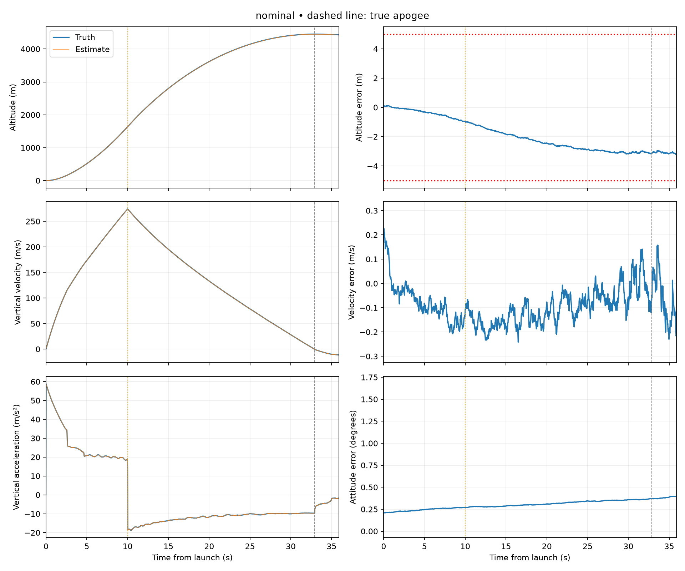
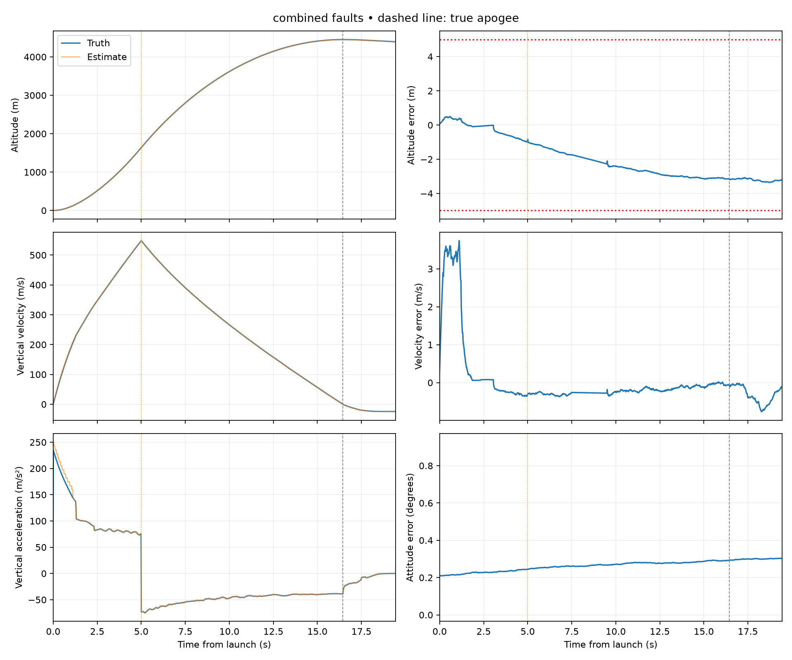

# Assignment #612: altitude, vertical velocity and attitude

The Python reference and portable C filter pass simulation and firmware checks. Hardware accuracy is still unverified: the available local CSVs are sparse GUI snapshots. The assignment remains in progress pending full-rate board replay, mounting verification, MCU timing measurements and team review. Nothing has been flashed.

## Results

`./flight_test -v` passed all 28 checks, including sanitizer unit tests, firmware size/format checks, C/Python replay and 966 fusion records recovered identically through sensor drivers, filter, eMMC and replay. A temporary reversal of the velocity prediction sign failed the unit suite as expected; see [mutation evidence](report/mutation.txt).

Full-flight simulation, seed 612:

| Scenario | Max altitude error | Max velocity error | Apogee timing error |
| --- | ---: | ---: | ---: |
| Nominal | 3.221 m | 0.307 m/s | 0.0042 s |
| Combined faults | 3.358 m | 3.741 m/s | 0.0053 s |
| Late GPS | 3.241 m | 0.261 m/s | 0.0174 s |

All meet the provisional <5 m altitude and <0.5 s apogee timing targets. These targets still need team agreement. C/Python maximum altitude difference is 0.00145 m; maximum velocity difference is 0.00165 m/s. Output timestamps, flags and dropped counts match exactly. Full numerical results, host timings and attitude errors are in [metrics.json](report/metrics.json).





Full-flight charts: [nominal](report/nominal.png), [combined faults](report/combined_faults.png), [late GPS](report/late_gps.png).

## Model and implementation

`reference.py` implements the NumPy float64 reference independently of `src/app/fusion.c`. Both consume the same raw records. State is `x = [h, v, b]`: height above launch, vertical velocity and vertical acceleration bias. Units are metres, seconds and radians internally. The quaternion `(w,x,y,z)` rotates IMU body axes into a z-up launch frame. Gravity aligns roll/pitch during at least 256 stationary IMU samples and eight pressure samples; mean stationary gyro readings set gyro bias. Yaw starts at an arbitrary zero and drifts without an external heading reference. Direction here means relative attitude, not an absolute compass heading or a three-dimensional velocity vector.

Gyro propagation uses the quaternion exponential of bias-corrected angular rate and renormalizes each sample. Rotate measured specific force into the launch frame, subtract gravity, and call its vertical component `u`. For interval `dt`:

```
h_next = h + v*dt + (u-b)*dt²/2
v_next = v + (u-b)*dt
b_next = b
F = [[1, dt, -dt²/2], [0, 1, -dt], [0, 0, 1]]
P_next = F P Fᵀ + Q
```

`Q` exactly integrates continuous acceleration noise density `qa` and bias random-walk density `qb = 0.0001`:

```
Q00 = qa*dt³/3 + qb*dt⁵/20
Q01 = qa*dt²/2 + qb*dt⁴/8
Q02 = -qb*dt³/6
Q11 = qa*dt + qb*dt³/3
Q12 = -qb*dt²/2
Q22 = qb*dt
```

`Q` is symmetric. Scalar observations use innovation `r=z-Hx`, variance `S=HPHᵀ+R`, gain `K=PHᵀ/S`, and Joseph covariance update `(I-KH)P(I-KH)ᵀ+KRKᵀ`. Barometric height is `44330*(1-(p/p0)^0.19029495)`. Timestamp age enters `H=[1,-age,0]` with an acceleration correction. Innovation gates reject pressure jumps. GNSS uses reported vertical accuracy and additional latency uncertainty; fixes establish an altitude origin only while on the pad. A late first fix cannot reset altitude in flight. Duplicate/backward sensor times and GNSS iTOW are rejected, with clock/week wrap accounted for.

Fresh high-g samples can replace saturated IMU acceleration. **Board fallback is disabled until the high-g mounting is measured.** Set `STAR_HIGHG_AXIS_X`, `STAR_HIGHG_AXIS_Y`, `STAR_HIGHG_AXIS_Z` to a verified signed permutation of axes 1–3. The portable core defaults to identity for synthetic replay; board code marks the unknown mapping `FUSION_HIGHG_UNALIGNED`. Do not assume replay defaults certify the board mounting. A >50 ms IMU gap or gyro saturation sets sticky attitude-lost status and uses conservative propagation without acceleration.

The worker owns the filter, receives records through a 32-message queue with zero producer wait, and emits `REC_FUSION=0x17` at approximately 50 Hz. Record 0x16 remains reserved for GUI configuration. Its 52-byte payload contains timestamp, height, velocity, acceleration, bias, quaternion, height/velocity uncertainties, flags and dropped count. The worker resets on sensor activation with the configured ranges. Queue losses are counted; lost IMU input invalidates attitude. No flight/deployment commands are generated. The GUI currently retains fusion records as unknown raw records.

## Simulation assumptions

Trajectory comes from `EngineDesign/archive/scrap_files/LE3_Flight_Data.csv`: apogee 32.887 s, 14605.289 ft; burnout 10.009 s. Pressure is synthesized with ISA, and attitude follows an explicitly prescribed smooth yaw/pitch trajectory. These are controlled assumptions, not measured LE3 attitude or atmosphere. Combined faults compress trajectory time by two, multiplying acceleration by four to exercise saturation; this is not an LE4 prediction.

The generator models raw integer quantization and saturation, IMU acceleration noise 0.04 m/s² with 0.06 m/s² z bias, gyro noise 0.005 deg/s/√Hz at 833 Hz and bias `[0.002,-0.001,0.003]` rad/s, high-g noise 0.25 m/s², pressure noise 1.2 Pa and +50 Pa offset, and GPS vertical noise 3 m with 80 ms latency and 30 s cold start. Combined faults include a 1.5 g high-g z offset, a 100 m transonic pressure-height jump, GPS outage and IMU clipping. All 160 injected barometric jumps were rejected; 938 samples used high-g fallback with known synthetic mounting. GPS fixes are suppressed above 4 g or 500 m/s.

Sensor references: [ISM330DHCX](https://www.st.com/resource/en/datasheet/ism330dhcx.pdf), [H3LIS100DL](https://www.st.com/content/ccc/resource/technical/document/datasheet/6e/c2/95/d9/3a/3f/4f/cb/DM00162193.pdf/files/DM00162193.pdf/jcr:content/translations/en.DM00162193.pdf), [MS5611](https://www.te.com/commerce/DocumentDelivery/DDEController?Action=srchrtrv&DocNm=MS5611-01BA03&DocType=Data+Sheet&DocLang=English), [MAX-M10S](https://content.u-blox.com/sites/default/files/MAX-M10S_DataSheet_UBX-20035208.pdf). The high-g conversion is 780 mg/digit at ±100 g. The 3 m vertical GPS noise, acceleration noise and selected pressure offset are simulation assumptions, not guarantees from those datasheets. A single seed and model do not establish a flight error envelope.

## Recording search and real replay

Found in `/Users/pranaydogra/Documents/`, with exact copies in `data/`:

| File | Duration | IMU samples | Median IMU gap |
| --- | ---: | ---: | ---: |
| `flight-data.csv` | 24.382 s | 28 | 0.902606 s |
| `flight-data2.csv` | 29.826 s | 34 | 0.903873 s |

Both contain IMU, high-g and barometer rows, but no GNSS fixes or known-height reference. Their schema resembles board GUI captures; hardware provenance is not independently authenticated. Neither provides enough contiguous samples for stationary initialization. Faithful replay produces zero outputs in both C and Python. No samples were interpolated or invented. Raw barometric relative heights span −1.329 to +0.747 m and −1.661 to +0.498 m respectively; these are pressure variations, not accuracy measurements. [Replay results and SHA256 hashes](report/real_replay.json).

No `.slg` recording was found in Documents or Downloads, and `Documents/STAR Flights/` was absent. The repository contains simulation truth. The examined Notion STAR meeting notes and Flight Computer components page contain planning/datasheets, not bench, elevator/car or drop-test recordings.

Drive does contain other hardware's flight recordings:

- [SD2 Flight 1, October 18, 2025](https://drive.google.com/drive/folders/1g0u9PaauWPu7rujr64BXQ5OlP_rS1LFc): Blue Raven HR/LR and Featherweight. Inspected HR headers show gyro, acceleration and quaternion fields at 2 ms spacing; Featherweight headers show position, altitude, vertical velocity and fix fields at one-second spacing.
- [SD2 Flight 2, November 29, 2025](https://drive.google.com/drive/folders/19dgTNCV3uEv_RxllQRhzGUBVq3hFTEk6): Blue Raven and Featherweight logs.
- [Excalibur IREC, June 11, 2025](https://drive.google.com/drive/folders/1BqRqhypLih9dfhf4bTdUlPF5Gt_MBRsG): Peanut HR/LR logs.

These could support a separate comparison after confirming units, mounting and synchronization. They do not demonstrate this board's recording chain, and have not been presented as target-board replay.

## Reproduce

From `firmware/Flight_Computer`:

```sh
python3 -m venv .venv-fusion
.venv-fusion/bin/pip install -r simulation/fusion/requirements.txt platformio
PIO="$PWD/.venv-fusion/bin/pio" ./flight_test -v
```

Standalone simulation after the gate has built the replay executable:

```sh
.venv-fusion/bin/python simulation/fusion/simulate.py --full \
  --out simulation/fusion/output \
  --c-replay .pio/flight_test/build_fusion/fusion_replay
```

For live CSV replay, use the ranges configured when capturing; physical CSV values are quantized back to raw counts:

```sh
.venv-fusion/bin/python simulation/fusion/replay_csv.py \
  simulation/fusion/data/flight-data.csv simulation/fusion/data/flight-data2.csv \
  --out simulation/fusion/output/real \
  --c-replay .pio/flight_test/build_fusion/fusion_replay \
  --accel-fs-g 16 --gyro-fs-dps 4000
```

For a full-rate board session, download `flight.slg` and its metadata through the GUI. Keep each session and its configured ranges together. The extractor checks block CRCs, session/epoch/sequence and record lengths:

```sh
.venv-fusion/bin/python simulation/fusion/extract_log.py flight.slg records.bin
.pio/flight_test/build_fusion/fusion_replay records.bin estimates.bin 16 4000
```

Those range arguments are examples, not auto-detected metadata. High-g fallback is disabled by default in both replay tools, matching the unconfigured board. After verifying the mapping, append three signed axes to the C command (for example `1 2 3` only for measured identity mounting), or pass `--highg-axes 1 2 3` to CSV replay. The synthetic harness explicitly selects identity. Replay rejects missing/invalid ranges and malformed axis mappings.

## Remaining acceptance work

Capture a stationary startup followed by known-height motion or a referenced board test, retaining full-rate raw records, sensor settings, mounting, timing and GPS/reference measurements. Replay without resampling, compare height/velocity/attitude against the reference, and report failures as well as errors. Confirm targets and filter assumptions with the team.

Build usage is 109,380 bytes flash (20.86%), 68,064 bytes DTCM (51.93%) and 117,248 bytes RAM_D1 (35.78%). Host filter state is 192 bytes; worker stack allocation is 2,048 bytes. Host nominal replay took 0.433 CPU seconds for 611,778 inputs including file I/O. Measure worst-case MCU execution time, stack high-water mark and queue occupancy under actual logging load before signing off the CPU budget.

ISA pressure altitude can differ from geometric altitude. The scalar bias does not represent all three-axis, thermal or mounting errors. Yaw remains relative; timing has no PPS-based fusion synchronization yet. Simulation and host checks do not replace board validation or team review.
